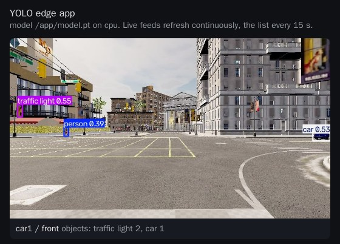
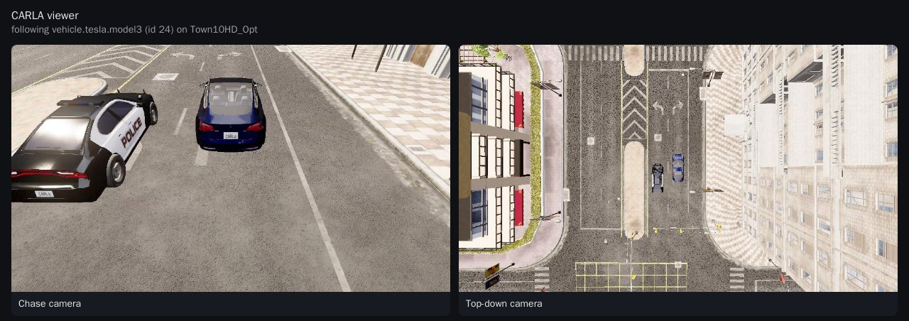

# CARLA camera feed over 5G

Uses the [CARLA](https://carla.org/) driving simulator as a camera source for a soft UE. A
vehicle drives on autopilot in a CARLA city, a camera mounted on it produces frames, and the
UE sends those frames over the 5G network to the [YOLO edge app](../yolo-edge/README.md).

```
CARLA server (GPU node) --Pod network--> CARLA client in the UE Pod
    --oaitun_ue1: UE -> gNB -> UPF--> YOLO edge app /ingest/frame/front
```

Only the UE -> YOLO hop crosses the 5G network. The client reaches the CARLA server over the
Pod network, because it simulates the camera, not traffic the UE would carry.

| File | Purpose |
|---|---|
| `carla-server.yaml` | CDK spec: headless CARLA 0.9.16 server on one GPU share. |
| `client/` | The CARLA client: source, Dockerfile and the CDK spec used to build and push it. |
| `carla-net.yaml` | rf-sim 5G SA network and the soft UE `car1`, which runs the client as a Terminal application. |
| `viewer/` | Optional browser view of the simulation: chase and top-down cameras on the ego vehicle. |

## Prerequisites

- Everything the [YOLO edge app](../yolo-edge/README.md) needs: the cluster-local registry,
  `brc` with `cdk app`, a `brc login`, and `docker` on the control-plane node.
- An NVIDIA GPU node with at least 8 GB of GPU memory, exposed as `nvidia.com/gpu`, and a
  `nvidia` RuntimeClass. `brc cdk app deploy` checks both. CARLA renders off screen with Vulkan.
- About 20 GB of free disk on that node: the CARLA image alone is 8.6 GB once unpacked.
- An Athena release that accepts Terminal applications (container names starting with `app-`).
- The `terminal/oai-ue` model (Falcon), and the `oai-ran` and `oai-cn` models.

## 1. Deploy the YOLO edge app

Follow steps 1 to 3 of the [YOLO edge app README](../yolo-edge/README.md). It runs as the
Service `yolo-edge`, which the client posts to.

## 2. Deploy the CARLA server

```bash
cd blueprints/apps/carla
brc cdk app deploy -f carla-server.yaml
brc cdk app status carla
brc cdk app logs carla -F
```

The image comes from Docker Hub (`carlasim/carla:0.9.16`) and its first pull takes several
minutes. The server is ready when the Pod reports `1/1` and the log shows the Unreal Engine
version line. It listens on the Service `carla`, ports 2000 to 2002.

`NVIDIA_DRIVER_CAPABILITIES=all` in the spec matters: CARLA needs the driver's graphics
(Vulkan) libraries, not only compute.

## 3. Build and push the client

```bash
cd client
brc cdk app build
brc cdk app push
cd ..
```

This only stores the image in the cluster-local registry as
`registry.<cluster>.local:5000/telco-fabric/<org>/carla-client:latest`. It does not deploy it.

## 4. Deploy the network and the UE with the client

Set the client image in `carla-net.yaml` to the one you pushed (replace `<cluster>` and
`<org>`), then:

```bash
brc install network carla-net.yaml
brc observe
```

The Terminal `car1` uses the plain `terminal/oai-ue` model. Its `applications` block adds the
container `app-carla-client` to the UE Pod. A container there shares the UE's network
namespace, so it sees the 5G interface `oaitun_ue1`.

The client waits for `oaitun_ue1`, connects to CARLA, spawns the ego vehicle and the traffic,
and starts sending:

```bash
brc extract logs oai-ue.car1.car1 | grep carla-client
```

```
INFO CARLA carla:2000 -> http://yolo-edge:9000/ingest/frame/front via oaitun_ue1 as car1
INFO CARLA server 0.9.16, client 0.9.16
INFO map Carla/Maps/Town10HD_Opt, ego vehicle.tesla.model3, 30 NPC vehicles, 19 walkers, camera 800x450 at 10 fps
INFO synchronous mode at 10 Hz, this client ticks the world
INFO sent 10.0 fps, 8.99 Mbit/s, rtt 47 ms, objects 5, dropped 0, errors 0
```

## 5. Watch the feed

Open the **YOLO Edge** tab in the MX-UI, or port-forward the Service and open
`http://localhost:9000/`. The feed appears as `car1 / front`.



To confirm the frames cross the 5G network, check where the YOLO app sees them from. With the
`oai-cn/minimal` core, the UPF source-NATs the UE traffic, so the requests come from the UPF
Pod, not from the UE Pod:

```bash
brc extract status upf.cn.carla-net
brc extract status oai-ue.car1.car1
brc cdk app logs yolo-edge --tail 20 | grep ingest
```

## 6. Watch the simulation (optional)

The feed shows only what the car's camera sees. The viewer attaches a chase camera and a
top-down camera to the ego vehicle and serves both on a web page, with a **CARLA viewer** tab
in the MX-UI:

```bash
cd viewer
brc cdk app build && brc cdk app push && brc cdk app deploy
brc cdk app status
```



It follows the vehicle whose `role_name` is `FOLLOW_ROLE` (default `hero`, the name the client
gives its ego vehicle), and picks it up again when the client restarts. It never ticks the
world: in synchronous mode it receives frames on the ticks of the client that drives it.
Settings: `CARLA_HOST`, `CARLA_PORT`, `FOLLOW_ROLE`, `FPS`, `WIDTH`, `HEIGHT`, `TOP_HEIGHT`
(metres above the vehicle) and `JPEG_QUALITY`.

## Client settings

The client reads its settings from the environment, set in the Terminal's `applications` block:

| Variable | Default | Meaning |
|---|---|---|
| `CARLA_HOST` / `CARLA_PORT` | `carla` / `2000` | CARLA server. |
| `YOLO_URL` | `http://yolo-edge:9000` | YOLO edge app. |
| `INTERFACE_5G` | `oaitun_ue1` | Interface the frames are sent from. Empty: the default route. |
| `ACTOR_ID` | Pod name | Name of this vehicle's feed in the YOLO app. |
| `CAMERA` | `front` | Camera name of the feed. |
| `FPS`, `WIDTH`, `HEIGHT`, `FOV` | `10`, `800`, `450`, `90` | Camera. |
| `JPEG_QUALITY` | `80` | Frame encoding. |
| `NPC_VEHICLES`, `NPC_WALKERS` | `30`, `20` | Traffic spawned around the ego vehicle. |
| `EGO_FILTER` | `vehicle.tesla.model3` | Blueprint of the ego vehicle. |
| `CARLA_MAP` | loaded map | For example `Town05`. |
| `TM_PORT` | `8000` | Traffic Manager port. Give each vehicle its own when several share a server. |
| `SEED` | random | Makes the traffic reproducible. |
| `TICK` | `1` | `1`: this client puts the server in synchronous mode and advances it. `0`: it only follows. |
| `SIM_FPS` | `10` | Simulation steps per second in synchronous mode, paced to wall-clock time. The camera fires on simulation time, so keep `SIM_FPS` at or above `FPS`. |

## Several vehicles

Add one Terminal per vehicle, each with its own IMSI, `ACTOR_ID` and `TM_PORT`. Exactly one
of them keeps `TICK=1`; set `TICK=0` on the others. They share the CARLA world, so
`NPC_VEHICLES` and `NPC_WALKERS` add up across clients.

## Known limits

- The client runs the server in synchronous mode, because CARLA's Traffic Manager steers
  reliably only there: with the server running free, autopilot vehicles leave the road within
  seconds. The server then renders one frame per simulation step. If it cannot keep up with
  `SIM_FPS`, simulated time runs slower than wall-clock time and the feed drops below `FPS`.
- CARLA keeps a GPU busy. Plan the GPU for CARLA alone, and run the YOLO app on CPU or on
  another GPU.
- The server spec has no health probes on purpose: CARLA's RPC server crashes when a probe opens
  and drops connections. Without probes it ran for more than 18 hours on our test cluster.
- If the client that ticks the world is killed in the middle of a session, the server can stop
  answering (clients fail with `time-out ... while waiting for the simulator`). Restart it with
  `brc cdk app deploy -f carla-server.yaml`; the client and the viewer reconnect on their own.
- The rf-sim UE can drop and re-attach. Periodic SRS on the gNB
  (`extras.t9s.io/do-srs: periodic`, already set in `carla-net.yaml`) keeps it stable. The
  client skips frames while `oaitun_ue1` is down.

## Removing

```bash
brc remove network carla-net.yaml
brc cdk app delete carla-viewer
brc cdk app delete carla
```
